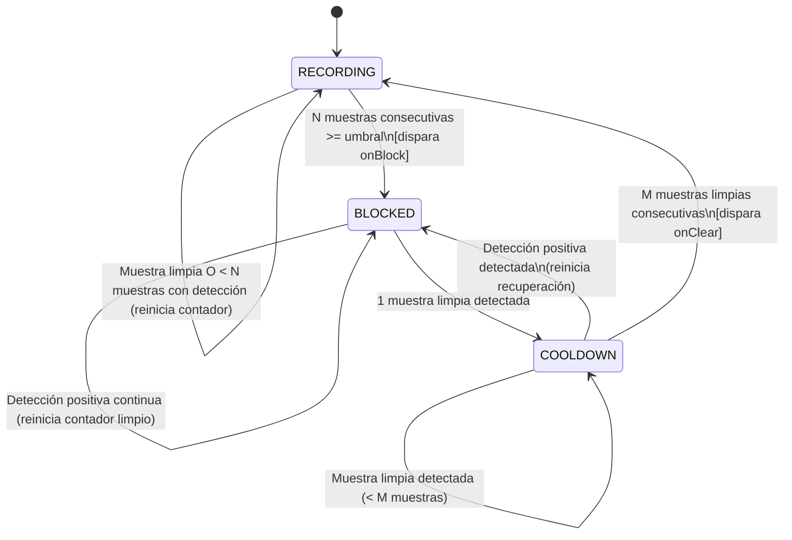

# Privacy Gate

Una máquina de estados determinística en TypeScript con histéresis temporal para pipelines de captura de cámara y grabación en tiempo real.

`PrivacyGate` funciona como una capa intermedia desacoplada entre un detector de inferencia visual (por ejemplo, detección facial o escaneo de documentos) y un pipeline de medios (grabación de video, captura WebRTC o persistencia de frames). Previene cortes bruscos e indeseados del streaming ocasionados por el parpadeo transitorio del detector (flicker) y asegura que ante intrusiones verificadas la emisión se bloquee de forma inmediata.

---

## Diagrama de Estados



### Estados Principales

- **`RECORDING`**: Flujo normal activo. Los frames se transmiten o graban sin restricción.
- **`BLOCKED`**: Violación de privacidad confirmada. La salida de video o grabación se interrumpe.
- **`COOLDOWN`**: La detección invasiva cesó. La compuerta espera $M$ frames limpios consecutivos antes de reanudar el flujo, evitando restauraciones inestables.

---

## Características

- **Filtrado por Histéresis**: Requiere $N$ detecciones positivas consecutivas para bloquear, amortiguando falsos positivos aislados y ruido del detector.
- **Recuperación con Cooldown**: Requiere $M$ muestras limpias consecutivas para volver a emitir; cualquier detección durante el cooldown reinicia la cuenta y vuelve a bloquear inmediatamente.
- **Modos de Operación**:
  - `enforce`: Bloquea activamente la salida (`isBlocked = true`) cuando hay violaciones.
  - `shadow`: Monitorea el pipeline de forma silenciosa para medir métricas (`wouldBlock`) y ajustar umbrales en producción sin afectar a los usuarios.
- **Umbrales Configurables por Categoría**: Asigna umbrales de confianza independientes por tipo de detección (ejemplo: `face: 0.65`, `document: 0.80`) con valor por defecto de respaldo.
- **Tolerancia a Fallos (Fail-Closed / Fail-Open)**: Manejo robusto de errores o frames corruptos con políticas configurables según los requisitos de seguridad.
- **Cero Dependencias**: TypeScript puro sin código nativo, sin dependencias de UI ni modelos de inferencia acoplados.

---

## Inicio Rápido

### Instalación

```bash
npm install
npm run build
```

### Uso Básico

```typescript
import { PrivacyGate } from "privacy-gate";

const gate = new PrivacyGate({
  mode: "enforce",
  consecutiveBlockFrames: 3, // Bloquea tras 3 frames consecutivos con detección
  recoveryCleanFrames: 5, // Restaura tras 5 frames limpios consecutivos
  rules: {
    face: 0.7,
    document: 0.8,
  },
  onBlock: (event) => {
    console.warn(`[PRIVACIDAD] Streaming pausado en t=${event.timestamp}`);
  },
  onClear: (event) => {
    console.info(
      `[PRIVACIDAD] Streaming reanudado tras ${event.cleanFramesElapsed} frames limpios`,
    );
  },
});

// Evaluar una muestra del pipeline de cámara
const result = gate.processFrame({
  timestamp: Date.now(),
  detections: [{ kind: "face", score: 0.88 }],
});

if (result.isBlocked) {
  // Pausar grabación o aplicar desenfoque al frame
}
```

### Integración con Detectores Reales (Patrón Genérico)

La compuerta evalúa observaciones discretas, desacoplándose de cualquier runtime o librería específica (como TFLite, ML Kit o ONNX):

```typescript
async function onFrameSampled(rawFrame: VideoFrame) {
  const result = await gate.processDetectorCall(async () => {
    // 1. Invocar el runtime del modelo (local o nativo)
    const detections = await runInferenceModel(rawFrame);

    // 2. Mapear al formato estándar { kind: string, score: number }[]
    return detections.map((d) => ({
      kind: d.label,
      score: d.confidence,
    }));
  });

  if (result.isBlocked) {
    frameRecorder.pause();
  } else {
    frameRecorder.write(rawFrame);
  }
}
```

---

## Decisiones de Diseño

1. **Histéresis Temporal frente a Disparos de Frame Único**:
   Los modelos de visión por computadora ejecutados en dispositivos cliente o móviles suelen sufrir fluctuaciones puntuales de puntaje debido a desenfoque de movimiento o cambios de iluminación. Exigir una ventana de $N$ frames de confirmación y un período de enfriamiento de $M$ frames minimiza interrupciones sin comprometer la privacidad.

2. **Modo Shadow para Observabilidad**:
   Activar reglas de privacidad directamente en producción con umbrales sin validar puede degradar la experiencia de usuario. El modo shadow permite cuantificar eventos `wouldBlock` y analizar tasas de error antes de imponer el bloqueo.

3. **Separación Determinística entre Lógica de Control e Inferencia**:
   Aislar la máquina de estados en una librería liviana en TypeScript permite ejecutar pruebas unitarias al 100%, portar el código entre Node.js, WebWorkers, navegadores y entornos edge, y mantener el control de flujo independiente del ciclo de vida de los modelos.

---

## Limitaciones

- **Sensibilidad a la Tasa de Muestreo (FPS)**: Los parámetros de histéresis ($N$ y $M$) son conteos discretos de muestras y no duraciones temporales fijas. Si la tasa de muestreo del detector varía (por throttling térmico o carga del CPU), el tiempo real de reacción cambiará de forma proporcional.
- **Capa Heurística en Espacio de Usuario**: Esta librería opera a nivel de aplicación; no reemplaza protecciones físicas ni indicadores de hardware provistos por el sistema operativo.
- **Impacto de la Latencia de Inferencia**: El tiempo hasta efectivizar el bloqueo depende de la latencia del modelo multiplicada por $N$. Para requerimientos críticos se debe asegurar una tasa de muestreo adecuada en el detector.

---

## Política de Desarrollo Limpio y Privacidad

Este proyecto fue desarrollado bajo una metodología de sala limpia (clean-room):

- Utiliza únicamente umbrales sintéticos y nombres de estados genéricos.
- No contiene código, esquemas, nomenclaturas internas ni configuraciones de proyectos comerciales o privados.
- No incluye secretos, credenciales, datos de usuarios ni endpoints externos.

---

## Licencia

[MIT](LICENSE) © 2025 Lucas F. Meneses
