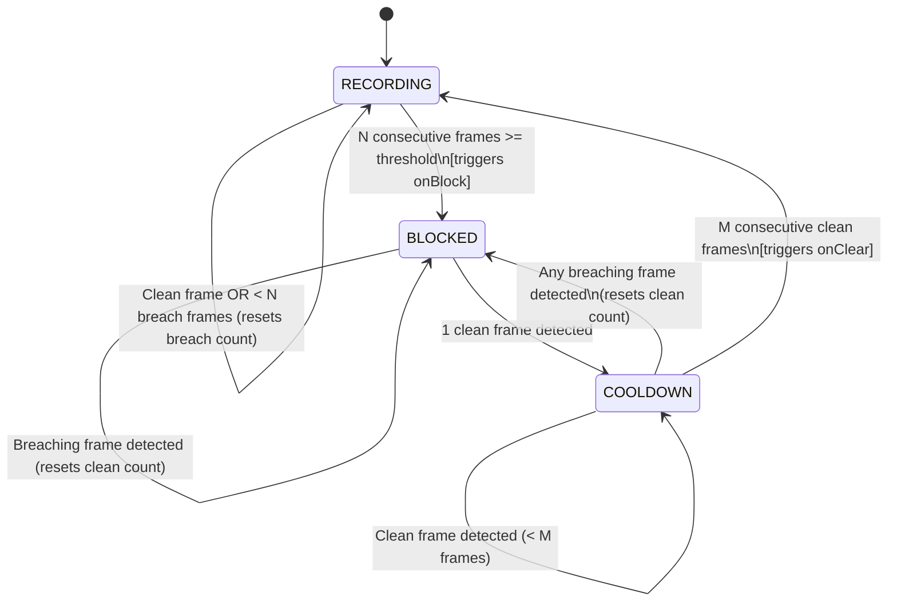

🇪🇸 [Leer en español](README.es.md)

# Privacy Gate

A deterministic, clean-room TypeScript state machine implementing temporal hysteresis for real-time camera and recording pipelines.

`PrivacyGate` acts as an intermediary layer between an upstream visual inference detector (e.g., face detection, document scanning) and a downstream media pipeline (e.g., video stream recording, WebRTC capture, frame storage). It prevents false-positive stream interruptions caused by transient inference flicker while ensuring that verified privacy intrusions immediately suppress the output.

---

## State Machine Architecture



### Core States

- **`RECORDING`**: Normal unsuppressed streaming. Incoming frames pass without restriction.
- **`BLOCKED`**: Privacy breach confirmed. Downstream frame output or recording is suppressed.
- **`COOLDOWN`**: Breach condition stopped. The gate waits for $M$ consecutive clean frames before restoring stream output, guarding against flickering recoveries.

---

## Features

- **Hysteresis Filtering**: Requires $N$ consecutive positive detections to trigger a block, absorbing single-frame false positives and detector jitter.
- **Guarded Recovery**: Requires $M$ consecutive clean frames to clear; any breach during cooldown resets the recovery counter and immediately re-engages the block.
- **Dual Operating Modes**:
  - `enforce`: Evaluates state and reports `isBlocked = true` whenever privacy violations occur.
  - `shadow`: Evaluates all state transitions and metrics silently without blocking the pipeline (`wouldBlock` tracking for safe threshold tuning in production).
- **Per-Kind Configurable Thresholds**: Define independent confidence cutoffs for specific detection labels (e.g., `face: 0.65`, `document: 0.80`) with fallback defaults.
- **Fail-Closed / Fail-Open Resilience**: Gracefully handles model crashes or malformed frames with configurable policies.
- **Zero Dependencies**: Pure TypeScript with no native dependencies, no UI framework bindings, and no model binaries bundled.

---

## Quick Start

### Installation

```bash
npm install
npm run build
```

### Basic Usage

```typescript
import { PrivacyGate } from "privacy-gate";

const gate = new PrivacyGate({
  mode: "enforce",
  consecutiveBlockFrames: 3, // Block after 3 consecutive breach samples
  recoveryCleanFrames: 5, // Restore after 5 clean samples
  rules: {
    face: 0.7,
    document: 0.8,
  },
  onBlock: (event) => {
    console.warn(`[PRIVACY] Video stream suppressed at ${event.timestamp}`);
  },
  onClear: (event) => {
    console.info(`[PRIVACY] Stream resumed after ${event.cleanFramesElapsed} clean frames`);
  },
});

// Process a sampled frame from your camera loop
const result = gate.processFrame({
  timestamp: Date.now(),
  detections: [{ kind: "face", score: 0.88 }],
});

if (result.isBlocked) {
  // Suppress video recording or blur output frame
}
```

### Integrating with Upstream Detectors (Generic Pattern)

The gate accepts discrete frame observations, decoupling the state logic from any specific inference framework (such as generic TFLite runtimes, ML Kit, or ONNX Web):

```typescript
async function onFrameSampled(rawFrame: VideoFrame) {
  const result = await gate.processDetectorCall(async () => {
    // 1. Invoke your local or native detector
    const rawDetections = await runInferenceModel(rawFrame);

    // 2. Map inferences into { kind: string, score: number }[]
    return rawDetections.map((d) => ({
      kind: d.label,
      score: d.confidence,
    }));
  });

  if (result.isBlocked) {
    frameRecorder.pause();
  } else {
    frameRecorder.write(rawFrame);
  }
}
```

---

## Design Decisions

1. **Temporal Hysteresis over Single-Frame Triggers**:
   Object detection models running on mobile or client edges regularly produce transient single-frame score anomalies due to motion blur, rapid angle shifts, or lighting changes. By enforcing an $N$-frame confirmation window and an $M$-frame stabilization cooldown, the gate minimizes pipeline flutter without compromising privacy guarantees.

2. **Shadow Mode for Observability**:
   Deploying privacy enforcement directly to production can result in unexpected user disruption if confidence thresholds are improperly calibrated. Shadow mode enables telemetry collection (`wouldBlock` counts and error rates) on real device streams before enabling active blocking.

3. **Deterministic Separation of State from Inference**:
   Heavy machine learning binaries should never be hardcoded into control flow logic. By isolating the hysteresis state machine into a pure TypeScript library, the engine remains 100% testable, portable across Node.js, WebWorkers, browsers, and edge environments, and completely decoupled from detector release cycles.

---

## Limitations

- **Frame Rate Sensitivity**: Hysteresis counts ($N$ and $M$) are discrete sample counts rather than absolute time durations. If your detector sampling rate varies significantly (e.g. throttling from 30 FPS down to 5 FPS under thermal load), transition latency will scale proportionally.
- **Client-Side Heuristic**: Privacy Gate is an application-level control layer. It does not replace hardware-level indicators (such as OS camera indicator LEDs) or native hardware secure enclaves.
- **Detector Latency Overhead**: The time required to block a stream is bounded by the inference latency of the upstream model multiplied by $N$. For ultra-low latency requirements, the upstream model must run at adequate FPS.

---

## Clean-Room & Privacy Assurance

This project is a clean-room implementation built from first principles:

- Generic synthetic thresholds and generic state transitions only.
- No proprietary code, schemas, internal naming conventions, or configuration values from any commercial or private projects.
- No secrets, tokens, customer data, or external analytics endpoints.

---

## License

[MIT](LICENSE) © 2025 Lucas F. Meneses
